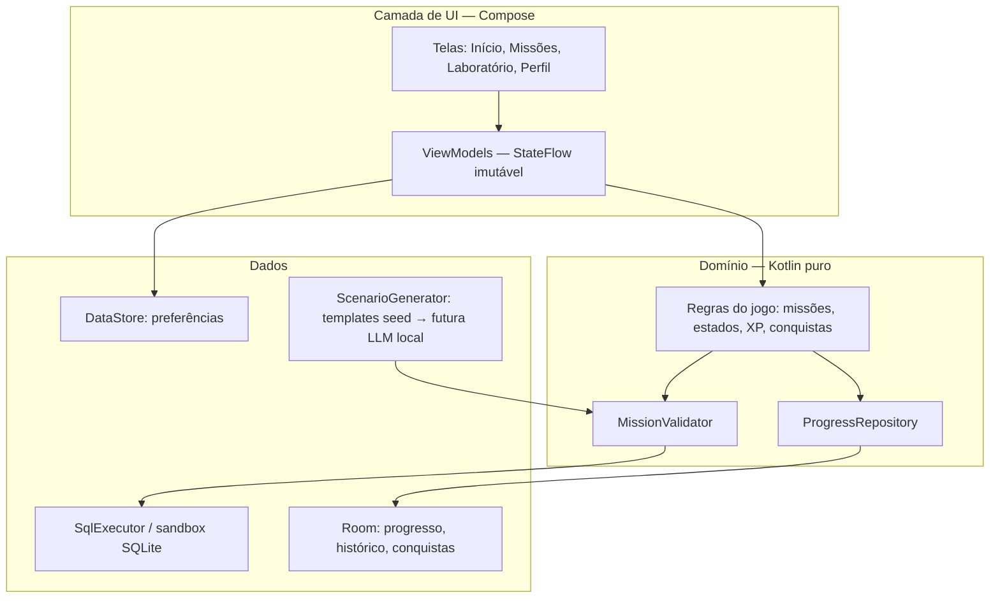

# ARCHITECTURE.md — Arquitetura alvo

Estado: documento inicial (M1a). Será detalhado conforme as camadas forem
implementadas (M6+).

## Visão geral

MVVM/UDF em camadas, módulo único `:app` com pacotes por feature (ADR-007).
A regra de dependência aponta sempre para o domínio, que é Kotlin puro, sem
imports `android.*`.

## Contratos de fronteira (seção 5 do Prompt Mestre)
- `SqlExecutor`: executa SQL real em sandbox; retorna `SqlOutcome`
  (Rows / Mutation / Rejected / Failed).
- `MissionValidator`: valida pelo estado do banco, nunca pelo texto do SQL.
- `ScenarioGenerator`: gera cenários; saída sempre não confiável até validada.
- `ProgressRepository`: eventos, XP, conquistas, histórico — idempotente.

## Regras
- Estado de UI imutável via StateFlow; eventos de uma via.
- Coroutines/Flow com dispatchers injetados; relógio injetável.
- Erros modelados em tipos selados — exceções não são fluxo normal.
- Domínio sem dependências Android nem do mecanismo de persistência.
- Nenhuma E/S de banco na thread principal (StrictMode em debug).

## Mapa de pacotes previsto (`com.fivedrat`)
- `ui/` — telas e componentes do design system
- `domain/` — regras do jogo, modelos, validador (Kotlin puro)
- `data/` — Room, seeds, repositórios, executor SQLite
- `lab/` — console SQL e visualização do laboratório
- `di/` — DI manual (ADR-002)
